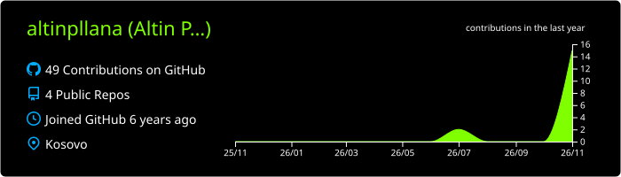
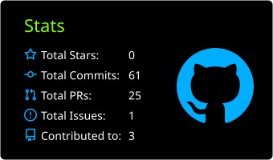
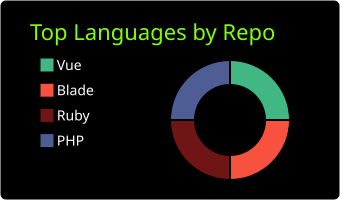
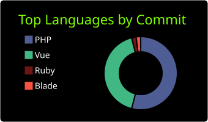
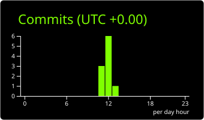

<!-- ░░░ ALTIN PLLANA :: PROFILE ░░░ -->
<p align="center">
  
</p>

<p align="center">
  <a href="https://bombstart.tech">
    
  </a>
</p>

<p align="center">
  <a href="https://bombstart.tech"></a>
  <a href="https://www.upwork.com/freelancers/altinpllana3"></a>
  <a href="https://www.linkedin.com/in/altin-pllana"></a>
  
</p>

---

```bash
altin@bombstart:~$ whoami
> Altin Pllana — CEO / Technical Lead @ Bombstart

altin@bombstart:~$ cat about.json
{
  "location":   "Kosovo — shipping for clients across EU & North America",
  "experience": "5+ years WordPress / WooCommerce engineering",
  "focus":      ["Figma → pixel-perfect WordPress", "WooCommerce", "Core Web Vitals", "SEO", "AI integrations"],
  "building":   ["AI SaaS products", "WordPress agents", "Chrome extensions"],
  "status":     "open to ambitious builds 🚀"
}

altin@bombstart:~$ ./run --mode=ship-it
[ OK ] design ...... locked
[ OK ] performance . 95+ lighthouse
[ OK ] deploy ...... live
```

## ⚡ Tech Arsenal

<p align="center">
  
  <br/>
  
</p>

<p align="center">
  
  
  
  
  
  
  
</p>

## 🛰️ Systems I'm Building

| Project | What it does | Stack |
|---|---|---|
| 🏢 **[Bombstart](https://bombstart.tech)** | Digital agency — WordPress, WooCommerce & AI builds for international clients | WP · Woo · Elementor |
| 🚗 **[Auto Ankand](https://autoankand.com)** | Online car auction platform for Kosovo | Web · Payments |
| 🤖 **Andy** | Agentic AI for WordPress — talk to your site, it ships the change | AI · WP REST |
| 🏠 **[Nivo](https://trynivo.ai)** | AI assistant for real-estate lead handling | AI · SaaS |
| 🚀 **[Landingly](https://landingly.net)** | AI landing page generator | AI · SaaS |
| 🔥 **[RoastMyCV](https://roastmycv.io)** | Viral AI CV roaster | AI · SaaS |
| 🧘 **[Zenlance](https://zenlance.net)** | AI CRM for freelancers | AI · SaaS |

## 📡 Telemetry

<p align="center">
  
</p>

<p align="center">
  
  
</p>

<p align="center">
  
  
</p>

<p align="center">
  
</p>

## 🧰 Open Source

| Repo | What it is |
|---|---|
| ⚡ **[wp-woo-snippets](https://github.com/altinpllana/wp-woo-snippets)** | Battle-tested WordPress &amp; WooCommerce snippets for performance, security and conversions |

## 🐍 Contribution Grid

<p align="center">
  <picture>
    <source media="(prefers-color-scheme: dark)" srcset="https://raw.githubusercontent.com/altinpllana/altinpllana/output/snake-dark.svg" />
    
  </picture>
</p>

---

<p align="center">
  <code>// building fast, clean, conversion-focused web — from Kosovo to the world</code>
</p>

<p align="center">
  
</p>
